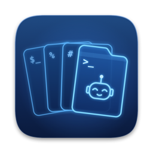

# Dealer

> **Disclaimer:** Dealer is 100% vibe-coded. I (Jon) don't know Swift, and I won't be able to
> maintain it properly: I don't trust coding agents to keep a codebase healthy over time, so
> expect the codebase to get out of hand.

A small macOS terminal built on **libghostty** (Ghostty's embedding API) and Swift/AppKit,
implementing the *Panes and Decks* layout model:

```
Window
└─ Workspaces  per-window; one shown at a time, switched with ⌃1–9
   └─ Decks      split side by side or stacked; each has its own tab strip
      └─ Tabs      one active per deck
         └─ Panes   split inside a single tab; hidden when their tab isn't active
```

A **workspace** owns a set of decks; a window has one or more and shows one at a time
(switch from the sidebar, the top-bar pills, or ⌃1–9). A **deck** owns tabs. A **pane** is
owned by a tab. Splitting always makes panes; **promote** turns a pane into a deck, **fold**
turns it back. Closing the last deck of a workspace closes the workspace, and closing the last
workspace closes the window.

## Demos

Short recordings, played back by Dealer's scripted demo mode (`scripts/record-demo.sh`). Steps go
through the same controller commands as the menus and shortcuts; drags are applied as the drop
they'd make, so no pointer is shown.

<details>
<summary><b>Panes and decks</b>: split, promote, fold, tabs per deck, moving a pane to another deck</summary>


[Full-quality MP4](https://github.com/jonsmithers/dealer/raw/media/demos/panes.mp4)
</details>

<details>
<summary><b>Workspaces</b>: the sidebar, switching with ⌃1–9, moving a tab to another workspace</summary>


[Full-quality MP4](https://github.com/jonsmithers/dealer/raw/media/demos/workspaces.mp4)
</details>

<details>
<summary><b>Agent attention</b>: waiting outline, ⌘⇧U jump, done dot</summary>


The states here are driven with `dealer notify`, which is exactly what Dealer's automatic
Claude Code hooks call (see [Attention](#attention-coding-agents)). This is not a live Claude
session: a real one shows its own permission prompt in the pane.

[Full-quality MP4](https://github.com/jonsmithers/dealer/raw/media/demos/attention.mp4)
</details>

## Build & run

Prerequisites: macOS 14+, Xcode command-line tools, `brew install zig@0.15` (Homebrew's default
zig 0.16 can't build the pinned Ghostty), ideally `/Applications/Ghostty.app` for shell integration
and terminfo, and a Ghostty checkout at the commit pinned in `scripts/ghostty.version`. The easiest
place for it is next to this repo:

```sh
git clone https://github.com/ghostty-org/ghostty.git ../ghostty
git -C ../ghostty checkout --detach "$(tail -1 scripts/ghostty.version)"
```

`build-ghosttykit.sh` looks for the checkout in `--ghostty PATH` / `$GHOSTTY_SRC`, then `../ghostty`,
then asks. It refuses to build a different commit unless you pass `--any-version`, because
libghostty's embedding API changes often. `--dry-run` shows what it would do.

```sh
scripts/build-ghosttykit.sh      # once: builds GhosttyKit.xcframework from the Ghostty checkout into vendor/
scripts/bundle.sh                # swift build + wraps build/Dealer.app (release by default; `debug` for a debug build)
open build/Dealer.app            # run it
```

Optionally, put `dealer` (the scripting CLI) on your `PATH` for use in other terminals.
It's already on `PATH` inside Dealer's own panes:

```sh
ln -s "$PWD/build/Dealer.app/Contents/Resources/bin/dealer" ~/.local/bin/dealer
```

The link survives rebuilds; point it at `/Applications/Dealer.app/...` if you copy the app there.

For development, `swift build && .build/debug/Dealer` runs the app unbundled. That build has no
macOS notifications and no `dealer` on `PATH` (use `.build/debug/Dealer <subcommand>` instead).
Every normal launch restores and overwrites your session (see *Session restore*). Use
`DEALER_SELFTEST=1 .build/debug/Dealer` to get a throwaway window that leaves the session alone.

Your normal Ghostty config (`~/.config/ghostty/config`) is loaded, and window chrome takes its
colors from your Ghostty theme (background/foreground, `unfocused-split-*`, `split-divider-color`).

## Keys

| Key | Action |
|---|---|
| ⌘T | New tab in the focused deck |
| ⌘D / ⌘⇧D | Split right / down (makes panes) |
| ⌘W / ⌥⌘W | Close pane / tab |
| ⌘1…⌘8, ⌘9 | Go to tab / last tab in the focused deck |
| ⌘⇧] / ⌘⇧[ | Next / previous tab |
| ⌘⇧P | **Promote**: pane → deck, hoisted to the window edge on its side, keeping its width |
| ⌘⇧F | **Fold**: deck → pane, back where it came from |
| ⌘⇧↑ | Select parent split (then ⌘⇧P promotes the whole group) |
| ⌘⌥←→↑↓ | Move focus by geometry, across decks |
| ⌘⇧↩ | Zoom: fill the deck, press again to fill the window, again to restore |
| ⌃⌘= | Equalize splits |
| ⌘N | New window |
| ⌃1…⌃9 | Go to workspace N |
| ⌃⌘N / ⌃⌘W | New / close workspace |
| ⌃⌘] / ⌃⌘[ | Next / previous workspace |
| ⌘B | Show / hide the workspace sidebar (sidebar mode only) |
| ⌘⇧U | Jump to the next pane that needs attention |
| ⌥⌘A / ⌥⇧⌘A | New agent pane / in a new git worktree |

These menu shortcuts win over Ghostty keybinds, so a `keybind` in your Ghostty config on one of
these keys never fires. Ghostty has no default ⌘B binding, but a `keybind = cmd+b=…` of yours is
shadowed by the sidebar toggle.

Double-click a tab to rename it; middle-click or hover × to close it. A pane's bar (shown once a tab has two panes) has the same hover ×, which closes the pane like ⌘W.

Workspaces are listed in a sidebar on the left: number, name, attention dot, and a dim line
with the focused pane's agent state, cwd and branch. Click a row to switch, double-click to
rename, right-click for a menu, middle-click to close, drag to reorder, "New Workspace" to add.
It shows by itself once a window has two workspaces; the toggle right of the traffic lights (or
⌘B) hides or shows it, and that choice is remembered per window. The Workspace menu also moves
the focused pane, tab or deck to another workspace or a new one, and reorders workspaces.

To put the switcher in the top bar instead, as numbered pills right of the traffic lights, pick
**Workspace › Workspace Switcher › In Top Bar** (or `switcher = "top"` under `[workspaces]` in
[settings.toml](#settings); `sidebar` is the default). The change applies to every open window at
once. Pills do the same things as rows: click, double-click to rename, right-click, middle-click
to close, drag to reorder, "+" to add, and take pane/tab drops. In top-bar mode the sidebar and
its toggle are gone and ⌘B is disabled; each window's sidebar choice is kept for when you switch
back.

### Tabs in the titlebar

With `[window] tabs_in_titlebar = true` in [settings.toml](#settings), the tab strips of decks
along the window's top edge move up into the titlebar row (like Safari's compact tabs), and those
decks start right under the titlebar. Each strip stays over its own deck. Decks lower down keep
their strips. The strips start after the traffic lights and the sidebar toggle, or after the
workspace pills in top-bar mode. A deck too narrow for that keeps its strip. Empty titlebar space,
including the space after a strip's tabs, still drags the window, and double-clicking it zooms or
minimizes per System Settings. Tabs there drag and drop as usual. The change applies live.

### Colors

Right-click a workspace (sidebar row or pill) or a tab for **Workspace Color** / **Tab Color**:
preset swatches, **Custom…** (the system color panel) or **None**. A workspace's color shows only on
its entry in the switcher (its sidebar row, or its pill in top-bar mode), as a chip and a faint
tint. It doesn't appear in the deck area or on tabs. A colored tab gets a faint tint and an underline in its color, which replaces
the deck's color on that tab. Uncolored tabs stay neutral. A tab's color moves with the tab;
a workspace's color stays with the workspace. Colors are saved with the session. From a script:
`dealer color -t workspace:2 teal`, `dealer color --tab '#e06c75'`, `dealer color --workspace none`.
In settings.toml, `[colors] auto_assign = true` colors each new workspace with the next unused
swatch, and `palette = ["#…", …]` replaces the swatches.

## Dragging

Drag a pane by its bar (shown once a tab has two panes; ⌥-drag grabs its parent split),
or drag a tab:

| Drop on | Pane | Tab |
|---|---|---|
| Edge of another pane | re-split beside it | rejoins as a split |
| Centre of another pane | swap the two | — |
| A tab strip | becomes its own tab (works across decks) | reorder / move to that deck |
| Window edge (past the decks) | promote to a new deck | becomes a new deck |
| A workspace in the sidebar (or its pill) | moves to that workspace as a tab | same |
| "New Workspace" in the sidebar (or the "+" pill) | moves to a new workspace, which you follow | same |
| Hover a tab | switches to it after a short delay | same |

## Attention (coding agents)

When an agent is **waiting** for input, its pane gets an accent-blue ring. The tab and the
workspace containing it get a blue outline and a blue dot, so you can see where you're needed
from anywhere. **Done** and **unread** (something finished or rang) are deliberately quieter:
a muted grey dot on the tab and workspace, with no ring or outline. The blue is a lighter shade
on dark ghostty themes and a deeper one on light themes. Focusing the pane clears all of it. **⌘⇧U** (Window > Jump to Next
Unread) goes to the most urgent pane in any window. When Dealer isn't the key window, it
also posts a macOS notification (bundled app only), and clicking it focuses the pane.

Sources:
- the bell (BEL);
- desktop notifications from OSC 9, OSC 99 and OSC 777;
- a shell command that ran for 10s or more finishing (needs Ghostty shell integration);
- `dealer notify` from inside the pane (the control socket/CLI, #5). Each shell gets
  `DEALER_PANE_ID`, so `dealer notify` targets its own pane by default.

### Claude Code hooks (automatic)

Every `claude` started in a Dealer pane reports *waiting* and *done* with no setup. That
covers `claude` typed at the prompt, an alias, an absolute path, and New Agent Pane. Dealer
ships a small Claude Code plugin (`Contents/Resources/claude-plugin/dealer`) and names it in
each pane's `CLAUDE_CODE_PLUGIN_DIRS`. If you already set that variable, Dealer appends to it.
Nothing is written to your `~/.claude` settings. The plugin's hooks:

- `PermissionRequest`: *waiting* the moment Claude asks to use a tool or approve a plan. It
  makes no decision; you still answer the prompt in the pane.
- `Notification` (`permission_prompt`, `elicitation_dialog`, `elicitation_url_dialog`):
  *waiting*. It leaves out `idle_prompt`, which would turn a *done* pane into *waiting*
  about 60 s after every turn.
- `Stop`: *done*.
- `StopFailure` (API errors such as rate limits or auth): *waiting*.

The hooks do nothing outside Dealer (no `DEALER_PANE_ID`). They also do nothing for
non-interactive runs (`claude -p`, the SDK), so an agent that runs `claude -p` from its Bash
tool doesn't mark its pane *done* mid-turn. A user `"disableAllHooks": true` turns them off
too. Needs Claude Code 2.1.280 or later; older versions ignore the variable.

**Turning it off**
- Everywhere: `inject_hooks = false` under `[agent]` in [settings.toml](#settings). New shells
  pick it up.
- For one shell or one launch: `export DEALER_CLAUDE_HOOKS=0`, or
  `DEALER_CLAUDE_HOOKS=0 claude`.
- If your organization's managed settings set `disableSideloadFlags`, Claude Code refuses to
  start with `CLAUDE_CODE_PLUGIN_DIRS` set. Dealer leaves the variable out when
  `/Library/Application Support/ClaudeCode/managed-settings.json` says so. Policy delivered by
  MDM or the server can't be detected, so turn the setting off.

**Manual recipe.** Use this for a `claude` that doesn't inherit a pane's environment, such as
one inside a tmux server started outside Dealer, or for Claude Code older than 2.1.280. Add it
to `~/.claude/settings.json`. The `DEALER_PANE_ID` guard makes it a no-op in other terminals.
If the plugin also loads, both fire, which is harmless: the same state twice is a no-op.

```json
{
  "hooks": {
    "PermissionRequest": [
      { "hooks": [{ "type": "command",
        "command": "[ -n \"$DEALER_PANE_ID\" ] && dealer notify --state waiting --title 'Claude Code' --body \"Permission: $(jq -r '.tool_name // empty')\" || true" }] }
    ],
    "Notification": [
      { "matcher": "permission_prompt|elicitation_dialog|elicitation_url_dialog",
        "hooks": [{ "type": "command",
        "command": "[ -n \"$DEALER_PANE_ID\" ] && dealer notify --state waiting --title 'Claude Code' --body \"$(jq -r '.message // empty')\" || true" }] }
    ],
    "Stop": [
      { "hooks": [{ "type": "command",
        "command": "[ -n \"$DEALER_PANE_ID\" ] && dealer notify --state done --title 'Claude Code' --body 'Finished' || true" }] }
    ],
    "StopFailure": [
      { "hooks": [{ "type": "command",
        "command": "[ -n \"$DEALER_PANE_ID\" ] && dealer notify --state waiting --title 'Claude Code error' --body \"$(jq -r '.error // empty')\" || true" }] }
    ]
  }
}
```

States are `waiting`, `done`, `unread` and `none` (clears the pane). Without any hooks, Claude
Code still sends its own OSC 777 notification (shown as *unread*) and OSC 9;4 progress
(*running*). [docs/claude-code-states.md](docs/claude-code-states.md) covers every state,
signal and timing, plus the research behind the automatic hooks.

Inside Dealer panes, `dealer` is on `PATH` (the bundle's `Contents/Resources/bin` is appended),
and `DEALER_CLI` holds its absolute path. Codex and other agents work the same way through their
own hook or notify settings. Anything that prints an OSC 9 notification
(`printf '\e]9;done\a'`) also works with no setup.

### Status and agent panes

The pane bar shows the pane's status on the right: agent state, cwd and git branch, e.g.
`waiting · ~/git/dealer · main`. The tab's tooltip shows the same line. The states are:
- **running**: the program is reporting progress with OSC 9;4. Claude Code does this while it works.
- **waiting** / **done**: from attention.

The branch is read from `.git/HEAD`, and worktrees work too.

**Shell > New Agent Pane** (⌥⌘A) splits the focused pane and starts an agent in the new pane.
**New Agent Pane in Worktree** (⌥⇧⌘A) first runs `git worktree add -b agent-N` into
`<repo>.worktrees/agent-N` and starts the agent there. The command is `claude` by default.
Change it with `command = "codex"` under `[agent]` in [settings.toml](#settings), or the
`DEALER_AGENT_COMMAND` environment variable (which wins).
It is typed into the pane's shell, so you're back at a prompt when the agent exits.

## Settings

Dealer's own settings live in `~/.config/dealer/settings.toml` (or `$XDG_CONFIG_HOME/dealer/`).
Terminal settings (font, colors, keybinds) stay in your ghostty config. **Dealer › Open Settings
File…** (⌘,) opens it, creating it from the commented
[docs/settings.example.toml](docs/settings.example.toml) if it doesn't exist yet.

```toml
[agent]
command = "claude"       # what New Agent Pane runs; DEALER_AGENT_COMMAND overrides it
inject_hooks = true      # load Dealer's Claude Code plugin in new panes

[workspaces]
switcher = "sidebar"     # or "top" (pills in the titlebar)

[window]
tabs_in_titlebar = false # put top-edge decks' tab strips in the titlebar row

[colors]
auto_assign = false      # color new workspaces with the next unused swatch
palette = ["#e06c75", "#98c379", "#61afef"]   # replaces the preset swatches

[jobs]                   # `dealer run` (see Scripting below)
placement = "split"      # or "tab" (a background tab next to yours)
size = 12                # job split height: rows, "30%" or "0.3"
close_on_success = true  # failed jobs always stay open
```

- Changes apply live: Dealer watches the file (editors that save by replacing it work too).
  **Dealer › Reload Settings** forces a re-read.
- A mistake never blocks launch. A bad value falls back to its default, and a banner in each
  window (plus a log line) lists the problems with line numbers.
- Menu toggles (like Workspace Switcher) write back to the file, changing only their own value
  and keeping your comments and layout. With no file yet, the toggle creates it from the example.
- Settings made with `defaults write dev.smithers.dealer …` before this file existed
  (`agentCommand`, `workspaceSwitcher`, `agentInjectHooks`) are still read when the file doesn't
  set that key. Dealer doesn't delete them.

Environment variables:

| Variable | Effect |
|---|---|
| `DEALER_AGENT_COMMAND` | Overrides `[agent] command` |
| `DEALER_CLAUDE_HOOKS=0` | Turns off Dealer's Claude Code hooks for one shell or one `claude` launch (`[agent] inject_hooks` turns them off everywhere) |
| `DEALER_SOCKET`, `DEALER_PANE_ID` | Set by Dealer in every pane; `dealer` uses them to find the app and its own pane (see [docs/cli.md](docs/cli.md)) |

## Scripting: `dealer`

`dealer` drives a running Dealer over a Unix socket: `create` panes/tabs/decks/workspaces
(`--side`, `--size`, `--cwd`, `--command`, `--title`, `--no-focus`), `send-text`, `focus`,
`resize`, `rename`, `identify`, `list --json` (IDs, cwd, foreground process and PIDs),
`find --process RE`, and `notify`. Commands are synchronous and IDs are stable. See
[docs/cli.md](docs/cli.md) for the reference and the `focus-nvim` recipe.

**Background jobs:** `dealer run <cmd>` runs a command without taking focus.
- **Where:** in the workspace that best fits your directory (the one with the deepest pane
  directory containing `$PWD`; yours on ties), as a short pane below that pane or a background tab,
  per `[jobs] placement`. If no workspace fits, it gets a new workspace named after the directory.
  stderr says which happened.
- **Title:** `RUN <cmd>`.
- **Success:** the job pane closes and your pane gets the *done* mark, plus a macOS notification
  if Dealer isn't in front.
- **Failure:** it stays open as a shell, titled `FAILED (status) <cmd>` and marked *waiting*, so ⌘⇧U
  takes you there.

```zsh
b() { dealer run -- "$@"; }               # b open ~/Desktop/Screenshot\ 1.png
b_str() { dealer run --quiet -- "$@"; }   # same, without the "done" mark
```

Several arguments are quoted word by word, so paths with spaces survive. A single argument is a
shell string, so `b 'make && make test'` and pipelines work. `--here` skips the routing. Details are in
[docs/cli.md](docs/cli.md#background-jobs-dealer-run-replaces-b--b_str).

## Session restore

Quitting saves the full window → deck → tab → pane tree (sizes, working directories,
tab names, focus) to `~/Library/Application Support/Dealer/session.json`; the next launch
restores it. Closing the last window by hand starts fresh next time. Sessions from the old
MyTerm location are copied over on first launch.

## Self-test

```sh
swift build && DEALER_SELFTEST=quit .build/debug/Dealer
```

Replays the design's walkthrough (tabs, panes, rearranging, decks, deep promote, fold,
group promote, focus, zoom, swap, tab moves, snapshot round-trip) against a live window
and asserts the tree after each step.

## Layout

- `GhosttyRuntime.swift` – `ghostty_app_t`, config, runtime callbacks (clipboard, actions, close)
- `SurfaceView.swift` – NSView hosting a `ghostty_surface_t`: keys + IME, mouse, sizing, focus
- `Model.swift` – generic binary split `Node`, `Pane`, `Tab`, `Deck`
- `TerminalWindowController.swift` – all structural operations and layout
- `DragController.swift` – pane/tab drag & drop targets
- `Views.swift` – deck, tab strip, pane bar, dividers, overlays
- `Session.swift` – save/restore
- `Workspace.swift` / `WorkspaceSidebar.swift` – workspaces, and the collapsible workspace sidebar + its titlebar toggle
- `Colors.swift` – workspace and tab colors: swatches, color menus, drawing, the active-workspace accent
- `WorkspaceBar.swift` / `WorkspaceSwitcher.swift` – the top-bar pill switcher, and choosing between it and the sidebar
- `Settings.swift` / `SettingsFile.swift` / `TOML.swift` / `SettingsBanner.swift` – settings.toml: schema and
  precedence, file watching, comment-preserving write-back, the minimal TOML parser, the problem banner
- `Theme.swift` – chrome colors derived from the ghostty config (light/dark), metrics, fonts, motion
- `ControlServer.swift` / `ControlHandler.swift` / `ControlNotify.swift` – control socket, request handler, `dealer notify`
- `SelfTest*.swift` – self-test, one file per feature section
- `AgentStatus.swift` – pane status line (agent state, cwd, git branch)
- `AgentLaunch.swift` – New Agent Pane presets
- `Demo.swift` – scripted demo mode for the README recordings (`DEALER_DEMO`, `scripts/record-demo.sh`)
- `Attention.swift` – per-pane attention (bell/OSC/agent), badges, jump to next unread, macOS notifications
